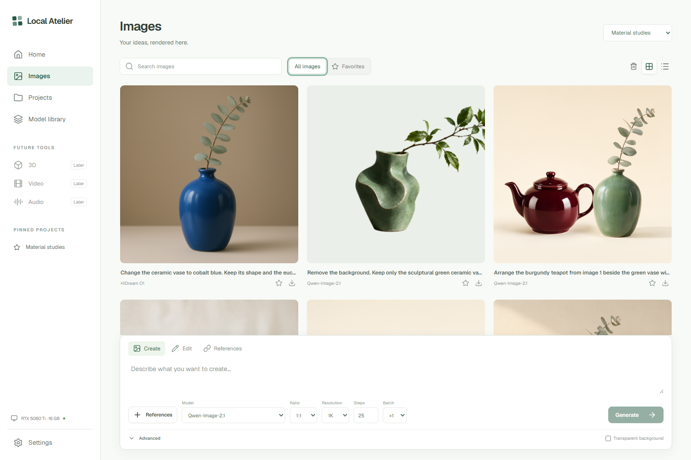

# Local Atelier

A local creative workspace for your own GPU. Organize projects, create images, edit references, and manage the models installed on your machine.

The application is free and MIT licensed. Inference uses your hardware; no hosted inference account or usage credits are required. Model weights have their own licenses, including the Qwen Research License.



## What works

- Light studio interface with Home, Images, Projects, Model library, and Settings.
- Project creation, renaming, descriptions, pinning, archiving, and restoration.
- Qwen-Image-2.1 with INT8 ConvRot diffusion and text encoder weights.
- HiDream O1 with SDNQ 4-bit weights and its image pipeline included in this repository.
- Text-to-image, single-image editing, and multiple reference images.
- Native transparent PNG output with Qwen; RGB output with HiDream.
- Aspect ratio, 1K/1.5K/2K export sizes, steps, seeds, batches, and a persistent job history.
- Search, favorites, grid/list views, image details, reusable settings, PNG/JSON downloads, and recoverable trash.
- Install/resume, publisher-checksum verification, and deletion of owned model installations.
- Automatic model switching: stop the previous worker before loading the next one on the GPU.

3D, video, and audio are marked **Planned**. No inference adapters for those services ship in this version.

## Windows setup

Requirements: a recent NVIDIA driver, a CUDA-capable NVIDIA GPU, [uv](https://docs.astral.sh/uv/getting-started/installation/), and Node.js 22 or newer. The target machine is an RTX 5060 Ti 16 GB with 32 GB of system RAM. Allow approximately 55–65 GB for both model installations and environments, plus space for outputs and package caches.

```powershell
git clone https://github.com/MaratG2/LocalAtelier.git
cd LocalAtelier
./setup.ps1
./start.ps1
```

If local script execution is restricted, run `powershell -NoProfile -ExecutionPolicy Bypass -File .\setup.ps1` for setup. Afterwards, `Start.cmd` opens the studio. This changes execution policy only for that process.

Open **http://127.0.0.1:7870**, visit **Model library**, and install a model. Installation downloads its pinned weights and creates an isolated GPU environment. Verification hashes every required file against the publisher's pinned manifest. A failed installation can be resumed from the same button. Internet access is needed for installation and verification; generation runs locally with offline model loading.

`./start.ps1 -NoBrowser` skips opening a browser. `./start.ps1 -Port 7871` changes the application port. Internal GPU worker ports 7892–7894 must be free. Close the studio with Ctrl+C to release its GPU workers.

## Self-contained storage

Everything belonging to the studio lives under this checkout:

```text
atelier/                     API, queue, runtime management and inference providers
frontend/                    React + TypeScript interface and bundled fonts
.venv/                       lightweight application environment
models/qwen-image-2.1/        Qwen weights, environment and pinned ComfyUI engine
models/hidream-o1/            HiDream weights and environment
data/atelier.sqlite3         projects, assets, settings and job history
data/assets/                 PNGs, thumbnails, reference images and metadata
data/runtime/                worker logs and temporary runtime files
```

There is no installation discovery, external generator adapter, folder linking, or dependency on another personal repository. Only official packages, the pinned ComfyUI engine, and published model weights are downloaded. Standard system tools and their caches are managed by their installers.

Weights, environments, local projects, generated images, and logs are excluded from Git. Back up `data/` with the studio stopped to preserve your work. Deleting a model removes only its owned installation; it keeps every project and image. Trash and archived projects are recoverable and continue to occupy disk space.

## Model profiles

| Model | Weights | Default steps | References | Transparent output |
|---|---|---:|---:|---|
| Qwen-Image-2.1 | INT8 ConvRot, about 17.3 GB on disk | 25 | Up to 10 | Native RGBA |
| HiDream O1 | SDNQ 4-bit, about 10.7 GB on disk | 50 | Up to 8 | No |

Disk size is not peak VRAM use. Qwen offloads components as needed; low-VRAM mode is available in Settings. HiDream keeps the vocabulary embedding/output head on CPU to make room for image inference. It renders at its model training scale before resizing to the requested export dimensions. Cold startup can take several minutes. Reference-heavy and larger jobs take longer and can need additional system RAM.

Start with 1K and the default steps. The queue runs one image at a time, accepts up to four jobs, and allows batches of up to four images. “Stop after image” preserves the image currently being rendered and skips the remaining batch. Jobs interrupted by a studio restart are marked interrupted; completed images remain available.

## Development

```powershell
# API checks use isolated temporary storage and a fake GPU worker.
.venv/Scripts/python.exe -m unittest discover -s tests -v

# Production build
cd frontend
npm ci
npm run build

# Optional frontend dev server; keep the API on port 7870 in another terminal.
npm run dev
```

The frontend development server binds to 127.0.0.1:5175 and proxies `/api` to the local API. The production application serves the built frontend directly. CI checks the API and frontend without downloading weights or requiring a GPU.

See [architecture](docs/architecture.md) for provider extension points, [hardware and browser checks](docs/verification.md) for measured results, and [third-party notices](THIRD_PARTY_NOTICES.md) for licenses. This release is a single-user, localhost desktop service; it has no remote account or multi-user server layer.
