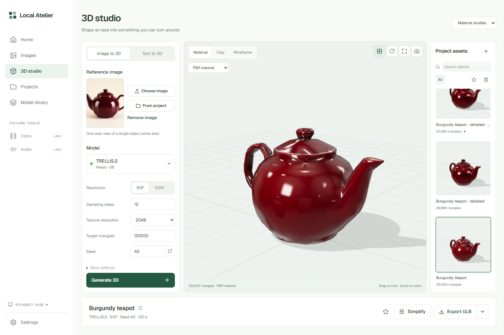

# Local verification

Tested on 10–11 October 2026, Windows, NVIDIA GeForce RTX 5060 Ti 16 GB, 32 GB system RAM. The image workers use PyTorch 2.13.0 with CUDA 13.0; the 3D worker uses the native CUDA runtime described below.

Both image models were installed into new, isolated environments under this repository. Existing weight bytes were copied into the owned bundles to avoid redundant downloads, then checked against the pinned publisher manifests. TRELLIS.2 was installed through its managed downloader. No runtime uses another application checkout, environment, server or weight path. Inference processes and their command lines were inspected during model switching.

## Real GPU checks

| Case | Steps | Output | Observed generation time |
|---|---:|---|---:|
| Qwen text-to-image, green vase | 25 | 1024×1024 | 39.37 s |
| Qwen text-to-image, burgundy teapot | 25 | 1024×1024 | 39.07 s |
| Qwen composition using both preceding images | 25 | 1024×1024 | 82.87 s |
| Qwen background removal using a landscape reference | 25 | 1024×704 RGBA | 36.80 s |
| HiDream text-to-image, blue cup | 50 | 1024×1024 export from 2048×2048 inference | 325.20 s |
| HiDream reference edit, recolor the vase | 12 | 1024×1024 export from 2048×2048 inference | 124.95 s |

Times include prompt/reference encoding, inference and result decoding/transfer after the worker is ready; they exclude process startup. These are individual observations, not averaged benchmarks. Cold startup took several minutes in newly created environments. HiDream used PyTorch SDPA attention, with its vocabulary tables offloaded to CPU. The Qwen transparent result had alpha extrema 0 and 255; it was not an opaque image with a drawn checkerboard. Reference aspect ratios are rounded to the model's 64-pixel grid.

The real queue exercised Qwen → HiDream → Qwen switching. The earlier worker process tree was stopped before the next model loaded. Installation and verification were exercised with the actual model files. Permanent model deletion was exercised against owned disposable test bundles, including refusal of outside paths and missing ownership markers; the real multi-gigabyte installations were retained.

## Automated and browser checks

- 43 API/runtime tests passed. The original 21 cover project archive/restore, asset recovery, PNG metadata and alpha persistence, validation, queue bounds and cancellation, active-reference protection, model-operation exclusion, owned deletion, tamper detection, refusal of unverified weights, origin/host guards, and refusal to adopt an occupied worker port. Twelve mesh tests add embedded GLB validation, actual geometry/material persistence, six export formats, image/text queue flows, model/reference protection, cancellation, simplification lineage, texture routes and bounded rendered previews. Ten video tests add frame alignment, preset/mode constraints, bounded media uploads, reference duration limits, preview continuation, parent protection, progress parsing, queue registration, H3 checksum failure and Windows cleanup after a worker log closes. GPU inference is replaced with explicit fixtures in these unit tests.
- TypeScript and Vite production build passed. The GitHub workflow repeats API tests and frontend compilation without GPU dependencies.
- In-app browser smoke checks covered the real home, project and image studio screens. Its viewport override did not hold the requested size, so regular Playwright Chromium checked explicit 1536×1024 and 390×844 viewports.
- Browser interaction checks passed: create/rename/pin/archive/restore project; favorite, list view, image details, PNG download, trash and restore; search and settings reuse; reference upload; model-delete dialog cancellation; diagnostics; mobile navigation and seed controls.
- No JavaScript errors, relevant console warnings, framework overlays, or horizontal overflow were observed in that run. The archive-list refresh and an asynchronous dialog-reopening bug found by the run were fixed and the flows retested.

## TRELLIS.2 GPU checks

Installed and fully checksum-verified `trellis.cpp` v0.8.1 and the pinned Q8 GGUF bundle (9,997,159,776 weight bytes). All runs used 12 mesh sampling steps, a 2048-pixel texture atlas and a 512-resolution PBR field. The geometry preset is independent of the atlas size.

| Case | Geometry | Actual triangles | Observed time |
|---|---:|---:|---:|
| Burgundy teapot from project image | 512³ | 30,000 | 120.24 s pipeline metadata |
| Same teapot, detailed geometry | 1024³ | 49,996 | 458.53 s wall clock |
| Treasure chest from text, including Qwen concept | 512³ | 30,000 | 413.38 s wall clock |

These are single observations, not averages. The first time includes native inference and mesh optimization, stopping before final asset serialization; the wall-clock measurements include the complete queued job and polling interval. The text test includes cold Qwen startup and a 1024², 25-step concept render. The saved concept was then passed to TRELLIS.2 after Qwen's process tree exited. Native inference is a new process for each mesh job.

The 1024³ run's sampled total GPU usage peaked at **8,067 MiB**, using `nvidia-smi` at approximately one-second intervals. The full text workflow peaked at **15,563 MiB** during Qwen, sampled about every two seconds. These totals include desktop/browser GPU use; they are not per-process CUDA allocation measurements and can miss short spikes. No out-of-memory error occurred in these runs. The 512³ image-only run was not instrumented for peak memory.

The real native-process cancellation check stopped a running job in **0.91 seconds** after the cancel request, left no result asset or job scratch folder, and released the active model. Cancellation during Qwen concept rendering and CPU simplification is cooperative at stage boundaries.

The generated meshes have UVs and actual base-color and packed metallic/roughness textures. All six export routes returned usable files. GLB and OBJ downloads were also exercised through the UI. Simplifying the detailed teapot to a 10,000-triangle target produced **20,264 triangles** while preserving UV/material boundaries; this confirms the UI's target-versus-actual distinction.

### 3D interface verification

The in-app browser displayed the live mesh workspace. Playwright Chromium exercised explicit 1536×1024 and 390×844 sizes because the in-app viewport override did not hold the requested dimensions. Checks covered image selection, text mode, material/clay/wireframe/channel views, rotation/reset, real simplification, export downloads, favorites, trash/restore, GLB import, and image-model filtering. Final checks also verified the complete Generate button remains visible, asset selection is stable, and actual rendered thumbnails replace CPU previews.

No JavaScript errors, failed application requests, framework overlays or horizontal overflow were found. Headless Chromium emitted GPU-readback performance warnings during preview capture. Vite reports a 672 kB minified 3D chunk; it is loaded only when opening the 3D studio, with a 171 kB gzip transfer. These warnings do not fail the build.

The final visual comparison retained the accepted concept's light/forest-green palette, existing navigation, settings/viewer/assets arrangement, and result/export footer. The live viewer shows actual generated geometry rather than the concept illustration. Settings include the controls the selected runtime really supports, and the narrower asset rail gives the viewport more space. Mobile stacks the controls, viewport and assets without horizontal scrolling.

[Mobile capture](screenshots/mesh-mobile.png)

## VDN-H3 GPU checks

Installed 56,658 MB of pinned model data (1,201 files) inside `models/vdn-h3`, with an owned Python 3.12 interpreter and CUDA environment. Full model checksums passed, as did native encoder import and SageAttention, cuDNN, linear and INT8 kernel probes. Runtime Git revisions and the patched Diffusers tree matched their pins. The optional Torch Flash backend was unavailable; the runtime selected SageAttention 2.

The default Light pipeline was exercised through the production application at `127.0.0.1:7870`. The first clip depicts a paper sailboat on a pond. All outputs below use actual H3 inference with stereo audio; no fixture or procedural generator runs in the production provider.

| Case | Actual output | Provider elapsed time | Sampled total GPU memory |
|---|---|---:|---:|
| Text preview, cold kernels | 448×256, 124 frames, 24 fps | 362.97 s | 15,352 MiB |
| Finish that preview | 896×512, 124 frames, 24 fps | 231.80 s | 14,953 MiB |
| First-frame teapot preview | 448×256, 73 frames, 24 fps | 255.35 s | 15,228 MiB |
| Video/audio-reference preview | 448×256, 56 frames, 24 fps | 237.67 s | 15,099 MiB |

Provider times include process startup, encoding where needed, sampling and media inspection, but exclude time waiting in the queue and final thumbnail registration. These are individual observations with other desktop applications open, not repeatable warm benchmarks. Total GPU memory was sampled about every two seconds with `nvidia-smi`; it includes the desktop/browser and can miss short spikes. None of these four completed runs encountered an out-of-memory error.

The finish receipt reports `first_pass_reused: true`: it reused the saved conditioning and eight-step pass, then performed the three-step refinement. Both MP4s decoded to 124 distinct frames. Audio decoded successfully as two channels at 32 kHz with nonzero signal. WAV exports retained stereo and the sample rate. The original preview and its continuation tensors remain available. Container duration is 5.175 seconds, including audio padding, versus 124/24 = 5.167 seconds of video.

The first-frame test used an existing burgundy teapot image from the local image studio. It produced a moving view of that teapot, with the reference's shape and glossy material visibly retained. The native encoder reported the image-to-video/audio task, and the saved clip contains stereo audio. This is a single image-conditioning example, not a consistency benchmark across subjects.

The reference test selected the earlier boat preview, including its sound, through the project picker. The native engine ran `ref2va_av` and produced a new 56-frame clip with nonzero stereo audio. Both reference tests decoded to distinct frames throughout. Separate audio-only references, last-frame-only conditioning and paired first/last conditioning remain untested on the GPU; their request validation is covered, and the adapter passes those inputs to the native runtime.

Real cancellation stopped a running encoder job in 1.13 seconds, registered no result, released the active model and left no native Python workers. It exposed a Windows cleanup race: an 834-byte encoder log remained after its process exited. Cleanup now retries briefly for delayed file-handle release; a regression test holding an actual Windows file open passed. The final retry has not yet been rechecked in a native cancellation run because the running server still needs a restart.

### Video interface verification

The live in-app browser exercised real playback, **Finish preview**, image-conditioned **Generate preview**, and selection of a generated clip as a video/audio reference. Regular Playwright Chromium checked explicit 1536×1024 and 390×844 viewports after the in-app viewport override failed to hold the requested size. The dedicated Browser plugin was not available.

Live production checks passed for page identity, meaningful content, absence of framework error overlays, console health, play/pause, seek, volume, mute, favorite toggling and settings reuse. All MP4, WAV, PNG and JSON export routes returned 200; MP4 byte-range delivery returned 206. Neither viewport had horizontal overflow. An isolated, clearly labeled playback fixture also covered quality/preview compatibility, frame controls, reference picker/removal and export UI before the model finished downloading. That fixture is not in the real project library.

The design comparison preserves the concept's four-column desktop arrangement, forest-green/ivory palette, compact type hierarchy, settings spacing, large video player and five-frame strip. Real clips retain their actual aspect ratio. Light replaces the concept's Medium default because only Light supports preview continuation. Aligned duration, model attribution, native quality descriptions and prompt labels for queued jobs add factual context. Downloads use one format-selection dialog; result actions sit below the player. Mobile stacks the settings, player and project rail. Control borders, heights, volume adjustment and queue labels were corrected during verification.

## Creative workflows and Russian localization (11 October 2026)

Version 0.4.0 adds English/Russian, temporary sessions, project art direction, and sprite-sheet/tileset tools. Local verification passed **53 backend tests**, the TypeScript check, a production Vite build, and **776 Russian translation entries** with static-text coverage, interpolation and plural-form checks. Ten new backend tests cover session isolation and disposal, saved-reference protection, temporary mesh/audio uploads, private Qwen content paths, query-free access logs, style precedence and overrides, grid constraints, alpha-preserving exports and Tiled JSON data. Existing image, mesh and H3 tests remain in the suite. The existing large lazy-loaded 3D chunk warning remains.

Regular Playwright Chromium exercised an isolated server at port 7871 with a clearly procedural grid fixture. The Browser plugin was unavailable. Desktop (1440×1050) and mobile (390×844) checks covered project creation with style, sprite generation and ZIP download, English/Russian switching without losing the prompt, all Russian routes, temporary-session blank drafts, result reminders, absence of private prompts in localStorage, explicit disposal and restoration of the normal draft. No JavaScript errors or horizontal overflow were observed. Separate handoff checks verified that a temporary image remains readable as a 3D reference and a video first frame, retains its session cookie without a disposal request, then becomes unavailable after explicitly ending the session.

The finish reviewer scored both findings resolved: internal temporary-image navigation and contrast of the new checkbox labels. All four supplied captures were valid. The correction retained the incumbent visual system and put the taller mobile composer in normal document flow.

These checks verify application behavior and deterministic exports, **not newly generated GPU art quality**. No fresh native Qwen, HiDream, TRELLIS.2 or H3 inference was run for this change. The preceding GPU measurements belong to earlier versions. At completion of these checks, the production server on port 7870 still reported 0.3.0 and required a manual restart to load the new backend; automatic approval review had blocked stopping that process. The new frontend build and source were ready. Close the existing studio with Ctrl+C, then run `./start.ps1`; confirm `/api/status` reports 0.4.0 before using temporary mode.

## Scope of these results

Maximum-reference-count jobs, all aspect ratios, 2K Qwen exports, all mesh settings, larger H3 canvases, longer H3 clips, higher H3 step presets, and other GPUs/drivers were not exhaustively tested in this application. Mesh quality was visually checked on the teapot and chest; this does not establish general reconstruction quality or printing readiness. Audio signal checks do not establish dialogue or lip-sync quality. Model capabilities in the catalog are not speed or memory guarantees for every setting. Standalone audio generation remains planned; LTX is deferred. GPU inference is not run in GitHub CI. See the [3D guide](3d-studio.md) and [video guide](video-studio.md) for workflow limits.
